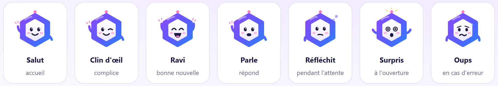

# Télécharger Hexa pour Windows

**Hexa, ton IA de bureau, joyeuse et discrète.**

**Hexa flotte sur ton écran Windows, répond à tes questions, garde tes tâches et dévore tes documents. Et avant chaque envoi à l'IA, il remplace tes données sensibles par des jetons.**

Hébergé dans l'UE · Tes contenus n'entraînent aucune IA · Dès 14,90 € TTC par mois

---

## Le projet Hexa

Hexa est né chez **IT6** d'une idée simple : offrir aux indépendants, aux TPE et aux équipes une IA vraiment utile au quotidien, **sans faire fuiter les données de leurs clients**.

Le projet tient en trois pièces :

| | Pièce | Rôle |
|---|---|---|
| 🖥️ | **Le compagnon Windows** | La mascotte qui vit sur ton bureau. Elle discute, gère tes tâches, lit tes documents et pseudonymise tout ce qui part vers l'IA, directement sur ton PC. |
| 🛡️ | **L'IA centrale d'IT6** | Le serveur hébergé dans l'UE qui gère les licences et les quotas, refait une seconde passe de masquage et applique les garde-fous avant de confier la demande à l'IA. Il ne conserve aucun contenu. |
| 💬 | **Hexa sur le site** | Le même personnage sur [it6.fr](https://www.it6.fr), pour accueillir les visiteurs et répondre aux questions. |

**Où en est-on ?** Version **3.0.0** disponible pour Windows 10 et 11. Ce n'est que la première pierre : de nouveaux pouvoirs arrivent à chaque version.

---

## Un petit hexagone, plein de super-pouvoirs

Hexa, c'est un compagnon violet et bleu qui vit dans un coin de ton bureau. Il cligne de l'œil, réfléchit, s'étonne, rigole. Et surtout, il bosse.

| | |
|---|---|
| 📄 **Glisse, dépose, c'est réglé** | Dépose un contrat, un rapport ou une facture, même scannée : Hexa propose de le résumer, le traduire, le relire ou d'en lister les dates clés. Un scan devient un Word modifiable ou un PDF où le texte se recherche. Jusqu'à 150 pages et 15 Mo. |
| 📊 **Tes factures en tableau** | Dépose tes factures et reçus, même scannés : Hexa en fait un Excel comptable avec totaux, TVA par taux et doublons signalés. |
| 🗂️ **Un dossier entier d'un coup** | Glisse un dossier : Hexa résume chaque fichier, en fait un tableau de synthèse ou convertit tout, jusqu'à 100 fichiers. |
| 🎨 **Aux couleurs de ton entreprise** | Logo, en-tête, pied de page et couleur de ta charte sur les Word, PDF et Excel créés, même sans Office. |
| ⚖️ **Contrats passés au crible** | Compare deux versions : changements de montants et de délais, clauses inhabituelles signalées en tête, Word avec suivi des modifications. |
| 🔍 **Tes chiffres vérifiés** | Rapprochement relevé bancaire / factures, doublons, montants hors norme et totaux faux repérés dans tes tableaux. |
| 🧾 **Devis et factures pro** | Devis, factures et avoirs en PDF aux couleurs de ton entreprise : numérotation, TVA et mentions légales gérées par Hexa. |
| 💶 **Qui ne m'a pas payé ?** | Factures en retard, relances prêtes à envoyer (jusqu'à la mise en demeure) et journal des ventes pour le comptable. |
| 📊 **Ton activité d'un coup d'œil** | Onglet Activité : facturé, encaissé, retards à relancer et devis à facturer, en un clic. |
| 👔 **À ton métier** | Comptable, juriste, RH, BTP… : Hexa adapte ses réponses, ses suggestions et même sa mascotte à ton métier. |
| 🗓️ **Ton activité, ton métier** | Raccourcis, échéances habituelles et vocabulaire de ton métier dans l'onglet Activité, avec rappel en un clic. |
| 📁 **Projets nommés** | Un dossier par client ou par affaire dans Documents\Hexa\Projets, devis et factures rangés dedans, rien n'est jamais écrasé |
| 🧰 **Boîte à outils de ton métier** | Les gestes clés de ton métier en un clic ; pour l'informaticien, des scripts .ps1 / .bat commentés avec mode simulation, jamais exécutés par Hexa |
| 🎨 **Créateur de modèles** | Ton SIRET, un thème, un logo : tes devis, factures et courriers à tes couleurs, avec les mentions légales |
| 💬 **Plusieurs discussions** | Une discussion par sujet, chacune avec son propre contexte ; gomme et balai pour effacer |
| ✏️ **Écrit pour toi dans Word** | Dis « rédige ce courrier dans Word » : Hexa ouvre Word, écrit sous tes yeux et enregistre. Un geste de souris et il te rend la main. |
| ✍️ **Rédige le premier jet** | Mails, courriers, réponses clients : un texte propre, prêt à copier, dans ton ton. |
| ✅ **Garde le fil de ta journée** | Tâches, rappels qui reviennent, minuteurs, notes : « rappelle-moi de relancer le devis lundi », et c'est noté. |
| 🌍 **Traduit sans trahir** | Une traduction qui garde le sens et le vocabulaire métier. |
| 📰 **Te tient au courant** | Météo, actualités, réponses à jour cherchées sur le web, avec la source. |
| 📱 **Te suit sur ton téléphone** | Avec Telegram, tu continues la conversation hors du bureau et tu reçois tes rappels. |
| ⚡ **Te fait gagner des clics** | Ouvrir une appli, lancer une recherche, copier un texte prêt à coller, verrouiller le PC quand tu pars. |
| 🧠 **Se souvient de toi** | Tes préférences et ton contexte de travail, pour des réponses qui collent. Tu peux lui demander d'oublier à tout moment. |

---

## L'IA ne voit pas tes vraies données

Avant chaque envoi, Hexa remplace sur ton PC les noms, IBAN, téléphones, e-mails, adresses, numéros de sécu ou de carte par des jetons. La réponse revient avec les vrais mots, remis **sur ton PC**.

| Ce que tu écris | Ce que voit l'IA |
|---|---|
| Mme Claire Fontaine confirme le virement de l'IBAN FR76 3000 6000 0112 3456 7890 189. | [PERSONNE_1] confirme le virement de l'IBAN [IBAN_1]. |

- Pseudonymisation sur le PC, puis une seconde passe sur le serveur central d'IT6
- Pour une image, dont le texte ne peut pas être masqué, Hexa te demande ton accord avant l'envoi
- Pour une recherche publique (l'adresse ou les horaires d'une entreprise, par exemple), seul le nom recherché part en clair, et Hexa te le dit
- Un bouton 🔓 permet d'envoyer un message sans masquage, au cas par cas, quand tu le décides
- Hébergement dans l'Union européenne
- Aucune réutilisation de tes contenus pour entraîner des modèles
- Historique, tâches et notes stockés sur ton PC, chiffrés, effacés après 30 jours, exportables et supprimables en un clic
- Tes propres termes à protéger (nom d'un client, d'un projet)
- Contrat de sous-traitance (DPA) inclus dans les offres pro

**Ce qu'Hexa refuse, toujours** : pornographie, piratage, deepfakes. Même « pour un test ».

---

## Les offres

| | **Solo** | **Pro** | **Équipe** |
|---|:---:|:---:|:---:|
| Pour qui | Particuliers, indépendants | Professions libérales, TPE | Entreprises, dès 3 postes |
| Prix | **14,90 € TTC / mois** | **29 € HT / mois** | **24 € HT / poste / mois** |
| Demandes par mois | 400 | 1 500 | 1 200 par poste |
| Contrat de sous-traitance (DPA) | | ✓ | ✓ |

Sans engagement en mensuel. Tarifs annuels et détails sur [it6.fr](https://www.it6.fr). Les entreprises peuvent aussi avoir un Hexa à leurs couleurs.

---

## Installer Hexa

| | Pour qui | Lien |
|---|---|---|
| 💿 **Installateur complet** | Première installation | [Hexa-Installation-3.0.0.exe](https://github.com/IT6-Dev/Hexa-Downloads/releases/download/v3.0.0/Hexa-Installation-3.0.0.exe) · [toutes les versions](https://github.com/IT6-Dev/Hexa-Downloads/releases) |
| 🔄 **Mise à jour** | Tu as déjà Hexa | [Hexa-Updates](https://github.com/IT6-Dev/Hexa-Updates/releases/latest) |

1. Télécharge l'installateur, puis double-clique dessus.
2. Si Windows affiche un avertissement, clique sur « Informations complémentaires » puis « Exécuter quand même ».
3. Hexa apparaît sur ton bureau et près de l'horloge.

Pour savoir si une nouvelle version existe : clic droit sur l'icône d'Hexa près de l'horloge → **Rechercher une mise à jour…** (Hexa vérifie aussi tout seul de temps en temps).

Configuration : Windows 10 ou 11. Pas encore disponible sur Mac. Le code source n'est pas publié ici.

---

**Hexa prépare, tu décides.**

Hexa est une intelligence artificielle : ses réponses peuvent contenir des erreurs. Vérifie les informations importantes. Un produit <a href="https://www.it6.fr">IT6</a>.

